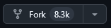
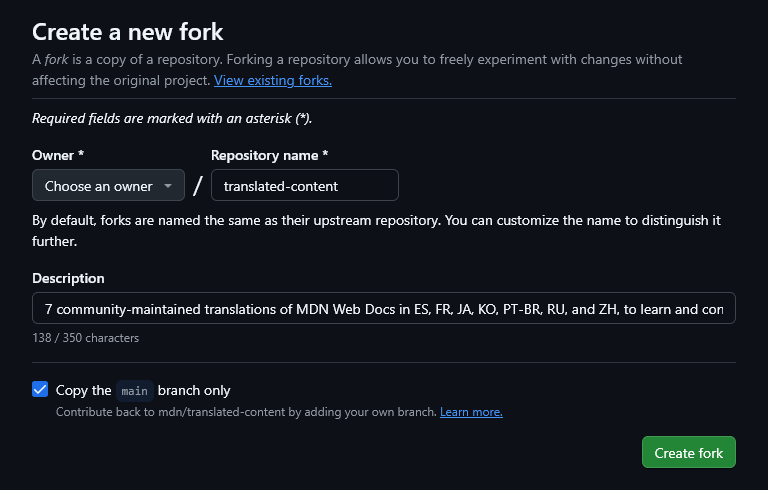
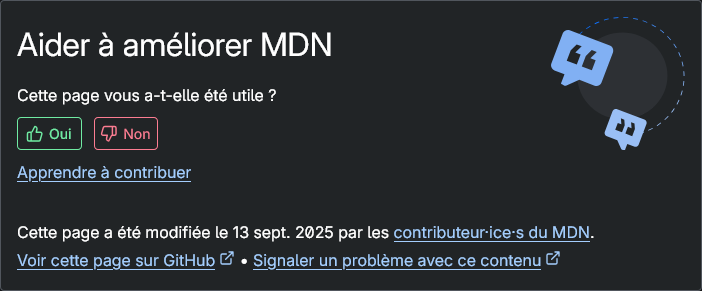
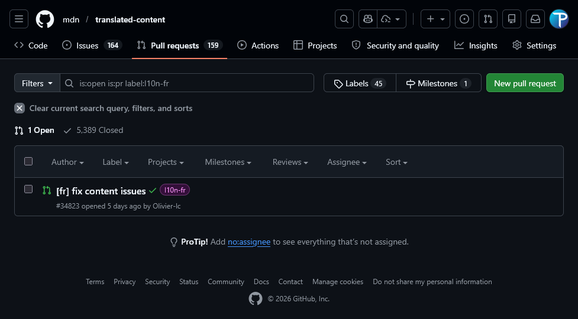

Ce guide vous présent la méthode de contribution au MDN par le biais de modification des pages Markdown en utilisant l'interface de Github. Les dépôts sont bifurqués pour permettre à chacun de faire des modifications sans impacter le dépôt principal avec des actions potentiellement dangereuses.

## Bifurquer le dépôt principal

import { Pencil } from 'lucide-react'

La bifurcation (<i lang="en">fork</i> en anglais) est une opération qui consiste à créer une copie profonde d'un dépôt pour apporter ses améliorations, tester dans son environnement local, développer sa fonctionnalité, avant même de proposer les modifications pour le fusionner dans le dépôt principal.

Voici les étapes à suivre pour bifurquer un dépôt, nous allons utiliser [le dépôt des traductions du MDN](https://github.com/mdn/translated-content) comme exemple&nbsp;:

1. Pour bifurquer le dépôt du MDN, rendez-vous sur la page de ce dernier et cliquez sur le bouton `Fork` situé en haut à droite de la page.

   

2. Une fois cliqué, vous devrez compléter un formulaire pour intégrer le dépôt dans votre compte Github comme copie, le nommer (si vous souhaitez changer son nom) et choisir si vous souhaitez copier toutes les branches ou seulement la branche principale (ce que nous recommandons).

   

3. Une fois effectué, vous pourrez naviguer dans le dépôt pour modifier la page que vous souhaitez.
   - Les pages sont rangées dans les dossiers `files/fr/`, ce qui rend les différentes catégories très structurées et faciles à naviguer.

     ```plain title="Structure du dépôt"
     📂 files
     │  …
     ├─ 📂 fr
     │  ├─ 📁 games
     │  ├─ 📁 glossary
     │  ├─ 📁 learn_web_development
     │  ├─ 📁 mdn
     │  ├─ 📁 mozilla
     │  ├─ 📁 web
     │  └─ 📁 webassembly
     └─ …
     ```

   - Les pages sont rangées de la même manière que le chemin qui est écrit à l'intérieur du fichier. Par exemple si vous cherchez l'attribut universel HTML `title`&nbsp;:

     ```markdown title="Structure vers «&nbsp;files/fr/web/html/reference/global_attributes/title/index.md&nbsp;»" {6-7}
     📂 files/fr
     └─ 📁 web
        └─ 📁 html
           └─ 📁 reference
              └─ 📁 global_attributes
                 └─ 📁 title
                    └─ 📄 index.md <- Ceci est le fichier qui décrit `title`
     ```

   - Pour retrouver rapidement la page, vous pouvez aller sur elle directement la page avec **«&nbsp;Voir cette page sur Github&nbsp;»** et ouvrir sa version Github en bas de page. Attention, vous serez redirigé sur le dépôt principal, il faudra changer le début du lien par le lien de votre dépôt bifurqué.

     

Félicitation, vous avez maintenant une copie du dépôt d'origine.

### Gérer les liens distants aux dépôts

L'exemple suivant porte sur le dépôt `translated-content`, mais vous pouvez appliquer ceci à d'autres dépôts.

Lorsque vous clonez le dépôt bifurqué sur votre machine, vous créez un lien vers le dépôt distant que Git appel «&nbsp;<i lang="en">remote</i>&nbsp;» en anglais. Préférez cloner le dépôt principal et ajouter votre dépôt bifurqué comme lien secondaire.

Pourquoi faire comme ça&nbsp;:

1. Le dépôt principal vous permet de récupérer le contenu récent facilement. Si vous utilisez l'outil de bureau de GitHub, il va vous proposer automatiquement de récupérer les dernières fusions.
2. Votre dépôt de travail est disponible par le biais d'une commande pour y envoyer les branches et n'a pas besoin d'être le dépôt en «&nbsp;origine&nbsp;».

Voici donc comment ajouter en dépôt secondaire votre version bifurquée du dépôt des traductions&nbsp;:

```bash title="BASH"
git remote add translation https://github.com/<votre-utilisateur>/translated-content.git
```

Si vous faites la commande suivante, vous verrez que vous avez 2 liens distants&nbsp;:

```bash title="BASH"
git remote -v
```

Vous devriez voir quelque chose comme ceci&nbsp;:

```plain
origin  https://github.com/mdn/translated-content.git (fetch)
origin  https://github.com/mdn/translated-content.git (push)
translation  https://github.com/<votre-utilisateur>/translated-content.git (fetch)
translation  https://github.com/<votre-utilisateur>/translated-content.git (push)
```

Récupérez les mises à jour du dépôt qui contrôle les contenus publiés depuis `origin` et publiez vos modifications vers `translation`.

Sur GitHub, vous pouvez mettre à jour votre dépôt bifurqué pour que sa branche `main` soit identique avec celle du dépôt d'origine grâce au bouton `Sync fork` disponible sur la page de votre dépôt bifurqué. Cela vous permet ensuite de synchroniser votre dépôt localement aussi pour que vos deux branches `main` soient à jour sur votre machine avec&nbsp;:

```bash title="BASH"
git fetch translation -p
```

Que fait cette commande&nbsp;:

- Elle récupère l'état de tous vos branches du dépôt bifurqué.
- Elle supprime la liaison des branches locales qui ont été supprimées du dépôt bifurqué. Cependant, vous devez supprimer les branches manuellement côté machine.

## Proposer des modifications

1. Une fois que vous êtes dans la page de votre dépôt bifurqué, vous pouvez cliquer sur le petit crayon (&nbsp;<Pencil size={16} />&nbsp;) pour éditer la page.
2. Modifiez le contenu que vous souhaitez changer puis, une fois que vous avez terminé, cliquez sur le bouton `Propose changes` pour proposer vos modifications. Un formulaire s'affiche pour vous demander le titre de votre instantané de modification. Nous recommandons d'utiliser les titres standardisés comme `chore(fr): description courte` pour des modifications de la documentation ou `fix(fr): description courte` lorsque vous corrigez des erreurs.
   Nommer de cette manière respecte les [conventions de nommages des instantanés de modification <sup>(angl.)</sup>](https://www.conventionalcommits.org/en/v1.0.0/#specification).

   Une fois la description courte écrite, vous devez choisir de «&nbsp;Créer une nouvelle branche&nbsp;» et la nommer. Si vous souhaitez vous retrouver entre vos branches, pensez à leur donner un nom facile à comprendre.

   :::warning
   Vous ne devez jamais modifier le contenu de la branche `main`, c'est pourquoi lorsque vous enregistrez la modification, vous créez une nouvelle branche. Comme ça, vous bifurquez la branche principale vers une version modifiée qui n'impacte pas la branche principale. Cela vous permet de garder la branche `main` à jour et l'actualiser à chaque fois que vous voulez mettre à jour votre dépôt bifurqué ou faire une nouvelle modification.
   :::

3. Une fois tout complété, vous pouvez retourner sur [le dépôt principal](https://github.com/mdn/translated-content) pour créer une requête de tirage (<i lang="en">pull request</i> en anglais) afin d'intégrer vos modifications dans le MDN. Si vous le faites directement après avoir enregistré la modification, un bandeau jaune s'affiche pour ouvrir directement la requête. Sinon, vous pouvez cliquer sur l'onglet `Pull requests` du dépôt principal et cliquer sur le bouton `New pull request` pour créer une nouvelle requête de tirage.

   

   :::info
   Il est important de bien compléter la description qui vous sera générée pour que l'équipe de relecture puisse comprendre les motivations derrière votre proposition.
   :::

Une fois cela effectué, vous pouvez continuer d'utiliser votre dépôt bifurqué pour modifier d'autres pages. Partez toujours de la branche principale (`main`) pour créer les branches de vos modifications.

Il ne vous reste plus qu'à attendre d'un membre de l'équipe de relecture vienne examiner votre requête, la corriger et la valider. Dans le cas où des erreurs seraient à corriger, vous aurez une liste des modifications nécessaires, à appliquer.

## Résumé

Nous avons vu dans ce guide comment mettre en place son dépôt bifurqué et comment contribuer en effectuant des modifications sur les pages depuis Github. À partir d'ici, vous pouvez faire des petites modifications pour mettre à jour ou corriger les pages du MDN. Pour effectuer des opérations plus complexes, nous vous invitons à lire le guide suivant qui vous apprendra à créer des pages, ajouter des images et utiliser un environnement local.
